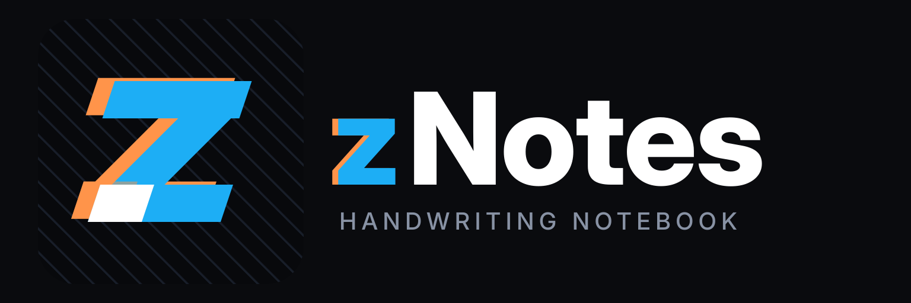

<p align="center">
  
</p>

<p align="center">
  <a href="https://github.com/ySimoz/znotes-android/releases/latest"></a>
  <a href="LICENSE"></a>
  
</p>

<p align="center">
  
  <br />
  <em>Annotating a PDF in dark mode, with the pages inverted</em>
</p>

<p align="center">
  
  <br />
  <em>Browsing imported PDFs in the gallery view</em>
</p>

---

## zNotes Added Features

Enhancements introduced in this fork:

- **Multi-Note Tab Bar & Switcher**: Open, view, and switch between multiple notes simultaneously without tearing down the OpenGL canvas context.
- **Folder Tree Sidebar**: Interactive hierarchical folder navigation in the backstage drawer with drag-and-drop file organization.
- **Unified 3-Dots Folder Actions**: Context menu on folders across all explorer views (Gallery, Grid, Columns, and sidebar Folder Tree).
- **Instant Preferences Engine**: Eliminated first-tap frame freezes with background pre-warming and off-screen pre-rendering, achieving 144Hz fluidity.
- **Honor Magic-Pencil Double-Tap**: Native tool toggling support for Honor Magic-Pencil 3 via keycode 755.
- **zNotes Cyberpunk Brand Identity**: Cyan/orange chromatic mark and instant vector brand launcher animation.
- **Multilingual Support**: Italian localization (`it`) alongside English, Simplified Chinese, and system default language selection in Preferences.

---

## Features

- **Ink that feels like a pen**: pressure-sensitive and low latency, with pens and highlighters.
- **Neon glow**: make any pen glow.
- **Disappearing ink**: ink that fades away on its own, great for teaching and presenting.
- **Shape snapping**: draw a rough shape, hold, and it snaps clean.
- **Sharp at any zoom**: ink and PDFs stay crisp however far you zoom in.
- **Notebooks and an infinite canvas**: pages when you want structure, endless space when you don't.
- **Book layouts**: single, double or cover pages, scrolling or page flips.
- **PDF import**: bring in any PDF and write all over it.
- **Room for side notes**: widen a PDF's margins on any edge and take notes on the side.
- **PDF text markups**: highlight, underline and strike out text, add comments, search it.
- **PDF colour filters**: invert, sepia, contrast, brightness, multiply and screen.
- **Images stay untouched**: filter a PDF and its photos and images keep their true colours.
- **Dark and OLED modes**: easy on the eyes at night, true black on OLED screens.
- **Real PDF export**: sharp vector output with selectable text, links and bookmarks.
- **Markdown**: write in markdown and it formats as you type.
- **Typed notes**: tables, LaTeX equations and code highlighting, right on the page.
- **20+ page templates**: Cornell, planners, music staves, isometric and more.
- **Endless themes**: any accent colour, eight styles for each, dual tone and Material You.
- **Make it yours**: rearrange the toolbar, float it or dock it on any edge, and pick its size.
- **Split view**: two notes side by side.
- **A real file explorer**: grid, gallery, list, column and timeline views, with plenty to customise.
- **Your notes, your folders**: notes are saved as files in a folder you choose, not locked away in an app's database, so you stay in full control of them.
- **Works with stylus pens**: S Pen and many others.
- **Always editable**: nothing gets flattened, so every stroke can be moved, restyled or erased later.
- **Private**: open source, no account, no ads, no tracking, no permissions.

## Install

Download the signed APK from [GitHub Releases](https://github.com/ySimoz/znotes-android/releases/latest).

## Build from source

Needs JDK 17, NDK 27.0.12077973 and CMake 3.22.1.

```bash
git clone https://github.com/ySimoz/znotes-android.git
cd znotes-android
JAVA_HOME=/path/to/jdk-17 ./gradlew assembleDebug
```
